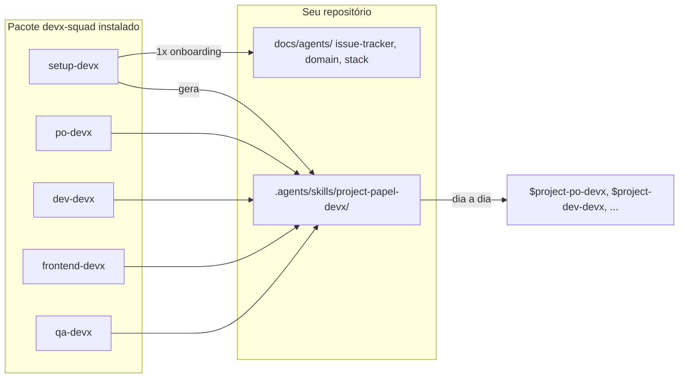
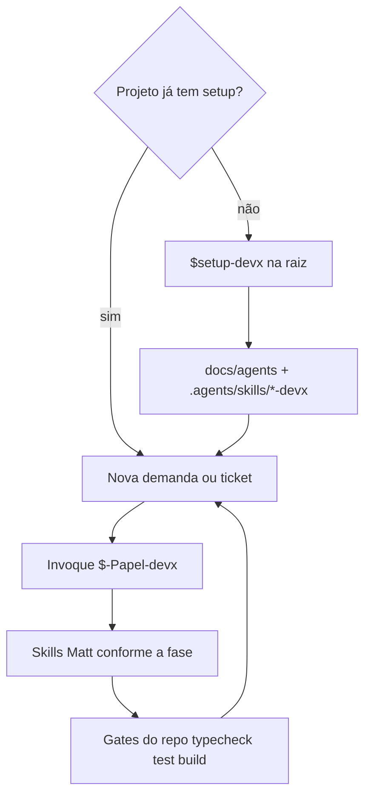
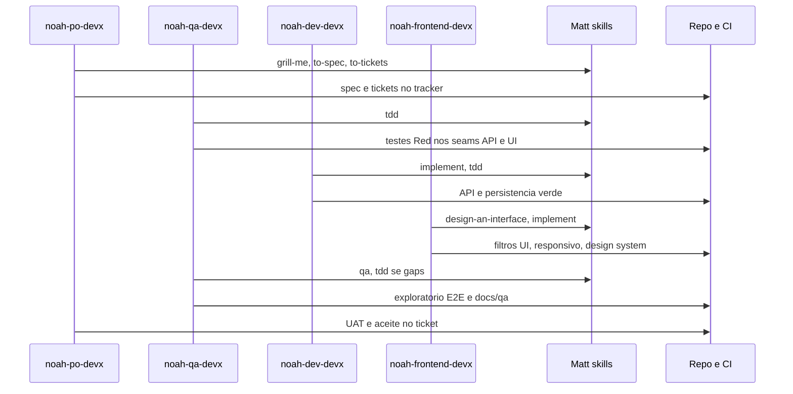
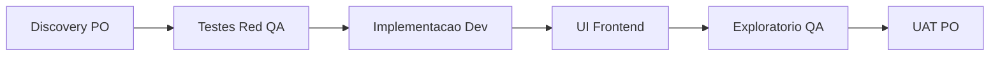
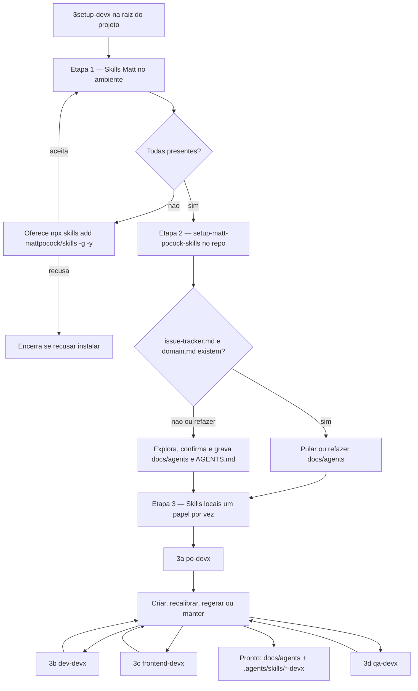

# devx-squad

Harness de agentes da [DEVX IT](https://github.com/devxit), integrado às [skills do Matt Pocock](https://github.com/mattpocock/skills). O squad entrega **personas especializadas** (PO, Dev, Frontend, QA) que primeiro **aprendem o seu repositório** e depois operam nele com regras explícitas do projeto.

## Conceito: global × local



| Camada | O quê | Quando usar |
| --- | --- | --- |
| **Skills globais** | Receitas de setup em `devx-squad/skills/*-devx` | Primeira vez no repo ou recalibração (`$po-devx`, `$setup-devx`, etc.) |
| **Skills locais** | `.agents/skills/<project>-<papel>-devx/SKILL.md` | Todo trabalho de esteira: stack, gates, vocabulário e fluxos **deste** projeto |
| **Matt Pocock** | `$tdd`, `$implement`, `$grill-me`, `$to-spec`, … | Execução técnica referenciada pelas skills locais |

Regra prática: se a skill local já existe, a global **não assume o papel** — você invoca `$<project>-<papel>-devx`. A global só volta com chamada explícita (ex.: `$dev-devx`) para recalibrar, regerar ou manter o arquivo local.

## Fluxo de uso no dia a dia



1. **Onboarding (uma vez):** `$setup-devx` — Matt no ambiente, `docs/agents/`, skills locais na ordem PO → Dev → Frontend → QA.
2. **Entrega contínua:** escolha a persona local alinhada à fase (spec, teste vermelho, código, UI, exploração, aceite).
3. **Evidência compartilhada:** `docs/agents/stack.md` (Core, Interface, Qualidade) e issue tracker em `docs/agents/`.

`copy-writer-devx` e `engine-discover-devx` são **paralelas à esteira técnica** — copy/CRO (`$copy-writer-devx`) e auditoria SEO, GEO, AEO (`$engine-discover-devx`); as duas se invocam mutuamente em LP completa, sem skill local por projeto.

## Exemplo: uma funcionalidade de ponta a ponta

Cenário fictício no projeto **`noah`**: *“Filtros avançados no catálogo de imóveis”*.



| Fase | Persona | Entregável típico |
| --- | --- | --- |
| 1. Discovery | `$noah-po-devx` | Escopo, critérios de aceite, tickets com label pronta para agente |
| 2. Red | `$noah-qa-devx` | Testes comportamentais falhando na pirâmide certa (contrato + E2E quando couber) |
| 3. Implementação | `$noah-dev-devx` | Backend/dominio verde, respeitando `stack.md` Core |
| 4. Interface | `$noah-frontend-devx` | Telas de filtro, estados vazio/erro, fidelidade ao design system |
| 5. Exploratório | `$noah-qa-devx` | Regressão, inventário `docs/qa/`, gates na ordem do projeto |
| 6. UAT | `$noah-po-devx` | Aceite ou devolução com evidência no tracker |

Ordem da **esteira técnica** (visão resumida):



## Setup rápido (`setup-devx`)

```bash
npx skills add devxit/devx-squad --skill setup-devx -g -y
npx skills add mattpocock/skills -g -y   # se ainda nao tiver
```

Na raiz do projeto alvo: **`$setup-devx`**.

1. Verifica skills Matt (`grill-me`, `tdd`, `to-spec`, `setup-matt-pocock-skills`).
2. Grava `docs/agents/` (tracker, domínio) via fluxo Matt.
3. Gera skills locais: **po-devx → dev-devx → frontend-devx → qa-devx** (QA por último, alinhado à Interface para E2E).

### Diagrama do setup



Na Etapa 3, Dev/Frontend/QA podem preencher `docs/agents/stack.md`. O **frontend** fecha escopo (perfil, PWA, motion, a11y, i18n) antes de gravar a skill local; o **QA** usa a camada Interface para E2E/UI.

## Instalação

Método suportado: **`npx skills add`**.

```bash
# Pacote completo no projeto atual
npx skills add devxit/devx-squad

# Global (~/.agents/skills)
npx skills add devxit/devx-squad -g

# Uma skill
npx skills add devxit/devx-squad --skill po-devx
```

Skills disponíveis: `po-devx`, `dev-devx`, `frontend-devx`, `qa-devx`, `copy-writer-devx`, `engine-discover-devx`, `setup-devx`, `skill-creator-devx`.

## Stack com evidência (`docs/agents/stack.md`)

Camadas **Core** (Dev), **Interface** (Frontend), **Qualidade** (QA), mais **Decisões em aberto** / **Sugestões arquivadas**. Stack existente no repo é documentada como vigente; melhorias são sugestões opcionais. Libs e comandos **não são inventados** — manifests, ADRs e `WebFetch` na doc oficial antes da skill local.

## Personas do squad

| Skill global | Persona local | Foco |
| --- | --- | --- |
| `po-devx` | `$<project>-po-devx` | Discovery, spec, tickets, UAT |
| `qa-devx` | `$<project>-qa-devx` | Pirâmide de testes, risco, exploratório |
| `dev-devx` | `$<project>-dev-devx` | Implementação full stack e gates |
| `frontend-devx` | `$<project>-frontend-devx` | UI sob medida ao arquétipo; PWA/motion só no escopo fechado |
| `copy-writer-devx` | *(sem local)* | Copy de LP — CRO, tom, microcopy, prompts de tela |
| `engine-discover-devx` | *(sem local)* | Auditoria de conteúdo — SEO, GEO, AEO, metadados, Schema |

## Layout do repositório

```text
.
├── README.md
├── LICENSE
└── skills/
    ├── po-devx/
    ├── dev-devx/
    ├── frontend-devx/
    ├── qa-devx/
    ├── copy-writer-devx/
    ├── engine-discover-devx/
    ├── setup-devx/
    └── skill-creator-devx/
```

## Licença

MIT. Veja [LICENSE](LICENSE).