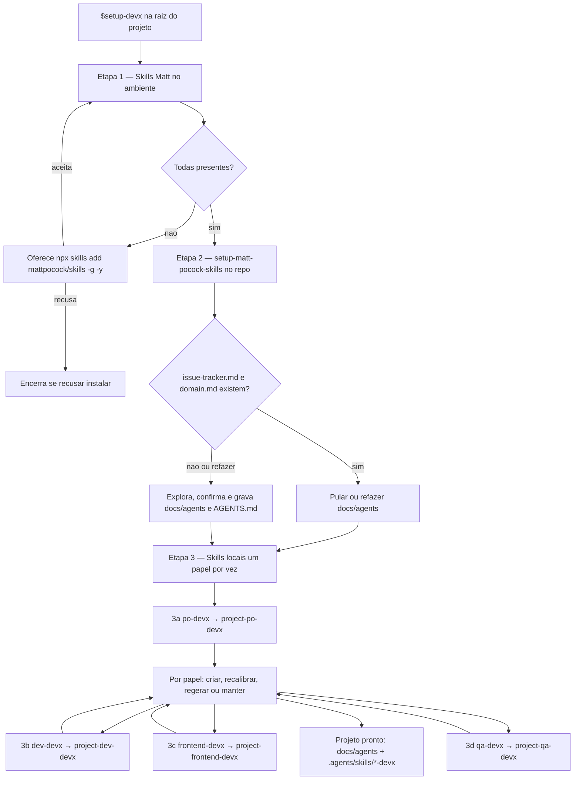

# devx-squad

Harness de agentes auto-adaptáveis da [DEVX IT](https://github.com/devxit), integrado às skills do Matt Pocock. Cada agente global lê o repositório em que é chamado e grava uma especialização local daquele projeto.

## Setup rápido (`setup-devx`)

A skill `setup-devx` faz o onboarding completo do projeto, novo ou existente:

1. Verifica se o pacote [mattpocock/skills](https://github.com/mattpocock/skills/tree/main) está no ambiente; se faltar, oferece `npx skills add mattpocock/skills -g -y`.
2. Executa o fluxo de `setup-matt-pocock-skills` no repositório (`docs/agents/`, issue tracker, domínio). Se `docs/agents/` já existir, pergunta se pula ou refaz.
3. Aciona **um por vez** as globais `po-devx` → `dev-devx` → `frontend-devx` → `qa-devx` para criar ou atualizar `.agents/skills/<project>-<papel>-devx/SKILL.md` (QA por último para alinhar E2E/UI à camada Interface).

```bash
npx skills add devxit/devx-squad --skill setup-devx -g -y
```

No agente, invoque `$setup-devx` na raiz do projeto alvo.

### Fluxo do setup



Durante a **Etapa 3**, Dev/Frontend/QA podem consolidar `docs/agents/stack.md` (camadas Core, Interface e Qualidade) conforme as skills globais. O **frontend** roda sabatina de escopo antes de gravar a skill local; o **QA** usa a Interface já definida para E2E/UI.

## Pré-requisito (uso manual)

Se não usar `setup-devx`, instale o Matt antes do squad:

```bash
npx skills add mattpocock/skills
```

## Instalação

O único método suportado é `npx skills add`.

Repositório inteiro, no projeto atual:

```bash
npx skills add devxit/devx-squad
```

Global, disponível em todos os projetos (`~/.agents/skills`):

```bash
npx skills add devxit/devx-squad -g
```

Uma skill específica:

```bash
npx skills add devxit/devx-squad --skill po-devx
```

O mesmo `--skill` vale para `qa-devx`, `dev-devx`, `frontend-devx`, `copy-writer-devx` e `setup-devx`.

## Auto-Bootstrap

Ao rodar `$po-devx`, `$qa-devx`, `$dev-devx` ou `$frontend-devx` num projeto, o agente escaneia o repositório (docs, stack, testes e código) e gera a especialização local:

```text
.agents/skills/<project>-<papel>-devx/SKILL.md
```

Exemplos: `.agents/skills/noah-po-devx/SKILL.md`, `.agents/skills/noah-qa-devx/SKILL.md`.

Essas skills globais existem só para o setup. Se `.agents/skills/<project>-<papel>-devx/SKILL.md` já existe e a global não foi chamada de forma explícita, ela é ignorada. O trabalho segue na skill local (`$<project>-po-devx`, `$<project>-qa-devx`, `$<project>-dev-devx` ou `$<project>-frontend-devx`).

Se a global for chamada de propósito (`$po-devx`, `$qa-devx`, `$dev-devx` ou `$frontend-devx`) e a local já existir, ela não assume o papel. Oferece três caminhos, porque os requisitos do projeto podem ter mudado: recalibrar a skill local, gerar uma nova no lugar, ou manter a atual. Sem essa escolha, o arquivo local não muda.

## Stack com evidência (`docs/agents/stack.md`)

No setup/recalibrar, `dev-devx`, `frontend-devx` e `qa-devx` consolidam a stack a partir de manifests, ADRs e código — **sem inventar** bibliotecas ou comandos. O artefato compartilhado `docs/agents/stack.md` usa camadas:

- **Core** (Dev)
- **Interface (Frontend)**
- **Qualidade (QA)**
- **Decisões em aberto** / **Sugestões arquivadas** (opcional)

Com stack já definida no repositório, cada papel **documenta o vigente** e pode **sugerir melhorias** como proposta; se você optar por **manter como está**, a skill local segue a stack atual. Libs novas só entram após sua aprovação (ou ADR). Antes de redigir a skill local, o agente consulta documentação oficial (`WebFetch`) das tecnologias confirmadas.

QA e Frontend não ficam limitados à visão do Dev: podem questionar e sugerir runners, frameworks ou recursos que impactem testes e UI, sempre como recomendação opcional.

No setup, `frontend-devx` infere o perfil do produto (SaaS, vitrine, landing, etc.), conduz sabatina obrigatória e grava a skill local **sem** assumir PWA ou motion imersivo por padrão; a11y e i18n entram só se você confirmar. A skill do projeto exige fidelidade a Figma/HTML/imagem dentro do design system e checagem de componentes reutilizáveis.

## Esteira

| Agente | Papel | Onde entra na esteira |
| --- | --- | --- |
| `po-devx` | Product Owner: discovery, spec, tickets e aceite | Discovery e UAT |
| `qa-devx` | QA: pirâmide de testes, risco e exploração | Testes Red e QA exploratório |
| `dev-devx` | Dev full stack: pattern mining e implementação | Implementação (DEV) |
| `frontend-devx` | UI sob medida ao arquétipo; PWA e motion imersivo só se o escopo fechar na sabatina | UI/PWA |
| `copy-writer-devx` | Copy de LP: CRO, SEO, GEO e AEO (duas fases; sem inventar fatos) | Marketing / conteúdo (fora da esteira técnica) |

Fluxo completo:

```text
Discovery → Testes Red → Implementação (DEV) → UI/PWA → QA Exploratório → UAT
```

`po-devx` abre o discovery e fecha o UAT. `qa-devx` escreve os testes no vermelho e faz o QA exploratório. `dev-devx` implementa a fatia. `frontend-devx` constrói a interface, o PWA e o motion.

## Layout

```text
.
├── README.md
├── LICENSE
└── skills/
    ├── po-devx/SKILL.md
    ├── qa-devx/SKILL.md
    ├── dev-devx/SKILL.md
    ├── frontend-devx/SKILL.md
    ├── copy-writer-devx/SKILL.md
    ├── setup-devx/SKILL.md
    └── skill-creator-devx/
```

`setup-devx` orquestra Matt + bootstrap das quatro skills locais. `skill-creator-devx` autora outras Agent Skills DEVX. As quatro primeiras são o harness da esteira.

## Licença

MIT. Veja [LICENSE](LICENSE).
